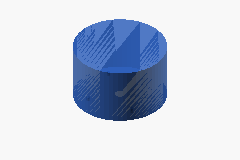

# Interactive CAD and engineering documentation

**Summary:** Browse the current pod-fit SCAD study and its owning Markdown
sections side by side in a local browser. Click a component in the 3D view to
open its documentation; click a **3D thumbnail** in the rendered documentation
to select and frame that component. No hosting or publishing is required.

**Status:** Unqualified sourcing-candidate fit study, not fabrication geometry
or authorization to build. It represents the 180 mm track, paired 120 mm printed
roller concept, paired 200 mm idler candidate, HPM5000B interfaces and current
DC HOUSE body envelope. **It does not fit as assembled.** The existing carrier
placement is retained so the clashes remain visible. The BOM baseline is not
changed by this study; brake and upper tensioner remain unmodeled.

## Modeled dimensions and limits

| Component | Relevant detail | Evidence / remaining assumption |
| --- | --- | --- |
| Track | 180 mm width, 72 mm pitch, 37 guide/tread positions; unequal-radius loop with sloping return | [Track candidate](../modules/01-structure-and-running-gear/running-gear.md#pod-fit-cad-assumptions). Code interpretation and belt mid-thickness pitch line unconfirmed; 20 mm belt, 24 x 24 x 20 mm guide lugs and 6 mm tread height are schematic |
| Drive drum | Flexible 350 mm OD, 180 mm axial envelope, central guide relief and hollow running bands | No selected tooth profile or load path; 10 mm shell and 40 mm guide channel are placeholders |
| Idler | Two 200 mm OD wheels, each 50 mm tread / 60 mm hub, 20 mm bore; 150 mm total axial envelope | [Interwheel 161.540 candidate](../modules/01-structure-and-running-gear/running-gear.md#s37-bearing-wheel-roller-and-idler-candidates), not an approved fit. Hub OD is schematic |
| Lower rollers | Two 120 x 50 mm wheels per assembly; 8 mm TPU tread, PC core, two 20 x 42 x 12 mm bearing envelopes per wheel; 140 mm total width | [Printed-wheel concept](../modules/01-structure-and-running-gear/running-gear.md#s38-3d-printed-roller-wheels-owner-proposed). 40 mm guide gap and 1 mm bearing recess are study values, not print tolerances |
| Motor | 206 x 126 mm body, 22.3 mm shaft / 53 mm projection, 5 x 43 mm keyway, four nominal M8 openings on 148 mm PCD | [Drawing evidence](../modules/02-drive-train/propulsion.md#s24-golden-motor-hpm5000b-family-specification). Hole depth, clocking and keyway axial offset are illustrative; threads and cooling details omitted |
| Battery | 504 x 268 x 233 mm body (length / transverse width / vertical height) | [DC HOUSE S30](../modules/04-battery-and-charging/batteries.md#s30-dc-house-100-ah-charger-bundle). Listing dimensions conflict with other supplier material; terminals, cables, handles and restraints need measured envelopes |

With the assumed pitch path, end-wheel horizontal spacing is **862.1 mm**.
The continuous inner return surface crosses the battery's upper front corner by
**90.1 mm**; the assumed guide-tip envelope increases that interference to
**110.4 mm**. The lower roller tops sit **40 mm above the retained carrier
underside**, intersecting its 90-100 mm height band and the battery base.
The 126 mm motor body + three 18 mm stages + 6 mm carrier total **186 mm**,
exceeding the 180 mm drum width by **6 mm** before brake/support/service needs.
The shaft occupies part of the schematic reducer volume, not an additional
53 mm in series; this is not a designed coupling.

OpenSCAD echoes these **FIT HOLD** values. Negative battery clearance remains a
visible clash, not a passed fit check. Repositioning the battery/carrier or
redesigning the running gear is a separate layout decision. Guide-lug sweeps,
tensioner travel, installation clearance and load capacity still require review.

## Open the local viewer

From the repository root, with Node.js 20+ and the `openscad` executable installed:

```sh
npm ci --prefix tool/cad-viewer --ignore-scripts
npm run export --prefix tool/cad-viewer
npm start --prefix tool/cad-viewer
```

Open `http://127.0.0.1:8765/`. The server binds to loopback only, serves no
firmware or credentials, and performs no hardware operations. Stop it with
Ctrl+C. Set `PORT` if needed; set `OPENSCAD` to an executable path if OpenSCAD
is not on `PATH`. PNG generation uses OpenSCAD's renderer and may require a
desktop session or configured offscreen display on Linux.

The browser previews exported SCAD geometry, not an embedded native OpenSCAD
session. **Editable SCAD** downloads the source to open in OpenSCAD; it cannot
launch the desktop application automatically. Markdown thumbnail links work
inside this local reader. GitHub and ordinary editor Markdown previews can show
the images but cannot run the viewer HTML; open the local reader first.

## Inspect components

[](viewer/index.html?component=motor)

**Click the motor thumbnail above** to frame the HPM5000B and open its
[price, specification and mounting documentation](../modules/02-drive-train/propulsion.md#hpm5000b-main-motor-candidate).
The same thumbnail route is available beside the motor in its owning scope.

- Drag to orbit, scroll to zoom, right-drag to pan.
- Click a visible mesh to open its owning section without leaving the viewer.
- Use **Component** for enclosed parts; **Isolate selection** or component
  visibility controls remove occluding parts. **Fit view** frames the selection;
  **Reset assembly** restores all geometry.
- To inspect motor mounting holes and the shaft keyway, isolate the motor and
  orbit to its shaft-side (negative Z) face; the default outboard view hides them.
- **Selected STL** downloads just that component in the original assembly
  coordinates, in millimetres. Planetary pitch-circle studies are grouped by
  stage; the four lower rollers are separate exports. The removal arrow is
  explicitly an annotation, not a physical part.
- Markdown links keep their scope and fragment in the reader. Browser Back and
  Forward restore the document/selection; the address can be bookmarked.

The [component map](viewer/components.json) owns each selectable ID, label,
color and exact documentation section. The
[SCAD source](module-01-track-pod-fit.scad) owns all geometry. Unmodeled
components have no invented mesh.

## Refresh and verify

After changing SCAD geometry, the component map, a targeted documentation
heading or a 3D study table, follow the
[CAD documentation sync skill](../../../.github/skills/cad-documentation-sync/SKILL.md)
and run one command:

```sh
npm run sync --prefix tool/cad-viewer
```

It checks that SCAD selectors, the component map, documentation anchors and
Markdown 3D links agree. Each component must have a Markdown entry point, and
each linked thumbnail must open its own component. It re-exports only when
stale: separate binary STL files and a freshness manifest go to ignored
`build/cad-viewer/`, and thumbnails go to `viewer/previews/`. `npm run check`
performs the same validation without writing. The server refuses stale or
incomplete exports at startup. Restart it after a component-map or geometry
change; nothing hot-reloads automatically.

```sh
npm run check --prefix tool/cad-viewer
npm test --prefix tool/cad-viewer
npm run test:browser --prefix tool/cad-viewer
```

The browser check uses Playwright Chromium, or `CHROME_PATH` for an installed
Chromium/Chrome executable. If neither is installed, install the test browser
with `npx --prefix tool/cad-viewer playwright install chromium`.

**Test-first evidence:** `core.test.mjs` initially failed for missing local
document/thumbnail routing and rendered anchors. `export.test.mjs` initially
exported the entire 1105 x 390 x 387 mm assembly when asked for the motor,
instead of the 206 x 206 x 126 mm body. These tests cover scoped navigation,
file-serving boundaries and isolated export in assembly coordinates.

**Initial viewer validation (2026-10-29, before candidate geometry):** Six contract/export tests passed, including the
unchanged assembly envelope and unknown-selector rejection. The browser check
passes thumbnail-to-model navigation, motor mesh raycasting, all 15 documentation
routes, section scrolling, bookmarks, Back/Forward, missing-document errors and
narrow layout. A delayed-document regression first restored the obsolete motor
URL after selecting the track; it now preserves the latest navigation. Export
freshness, JavaScript syntax, linked-cost freshness and engineering references
also pass. These software checks do not qualify physical geometry or operation.

**Candidate geometry test-first update (2026-10-29):**
`node --test tool/cad-viewer/export.test.mjs` first failed on the old 126 mm
motor-only envelope, 80 mm solid rollers, 200 mm track and 350 mm solid idler.
The updated mesh tests check actual material/void probes at motor mounting
holes and keyway, paired-wheel guide gaps, shaft bores, bearing recesses, track
lugs and treads, plus candidate battery/idler bounds. All five geometry tests
then passed. These checks cover represented features, not supplier conformity.
