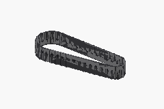
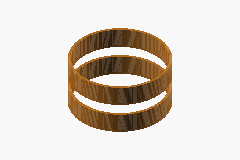
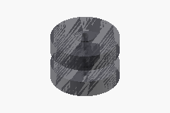
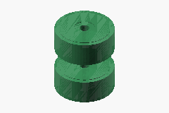

# Tracks and running gear

**Status:** DRAFT / HOLD; engineering estimate and unqualified requirements.
No procurement, fabrication, energizing or operation is authorized.

**Summary:** Follow the track around the drive drum, support rollers, idler,
and tensioner. Nominal track size and layout choices are study inputs;
matched profiles, bearings, clearances, and load ratings remain unqualified.

## Parts at a glance

| Part to inspect | Current choice / status | Cost and specifications | Fit / next component |
| --- | --- | --- | --- |
| [Rubber track](running-gear.md#ps01-rubber-tracks) | PowerTrack `180×72×37` sourcing preference; `200×72×36` remains the unchanged baseline study reference | [Found prices](running-gear.md#prices-found-tracks-rollers-and-idlers) · [Baseline allowance](running-gear.md#0101-rubber-tracks) · [Track requirements](running-gear.md#ps01-rubber-tracks) | [Drive drum engagement](running-gear.md#drive-drum-study) |
| [Drive drum / sprocket](running-gear.md#drive-drum-study) | 350 mm physical OD is a flexible study placeholder; tooth/profile match open | [Baseline sprocket/hub allowance](running-gear.md#0102-sprockets-idlers-rollers-and-tensioners) · [Drum study](running-gear.md#drive-drum-study) | [Motor-to-track mounting](../02-drive-train/propulsion.md#motor-to-track-mounting) |
| [Lower support rollers](running-gear.md#lower-support-rollers) | Bearing-wheel route; printed 120 mm PC/TPU wheels owner-selected, Interwheel 160 mm fallback; four assemblies per track in the study; fit and capacity unqualified | [Found prices](running-gear.md#prices-found-tracks-rollers-and-idlers) · [Roller allowance](running-gear.md#0102-sprockets-idlers-rollers-and-tensioners) · [Roller definition](running-gear.md#lower-support-rollers) | [Axles and bearings](running-gear.md#ps03-axles-bearings-and-track-guides) |
| [Upper rollers and spring tensioner](running-gear.md#spring-tensioner-concept) | Motorcycle-fork/spring concept; no qualified fork selected | [Roller/tensioner allowances](running-gear.md#0102-sprockets-idlers-rollers-and-tensioners) · [Travel/load requirements](running-gear.md#ps02-sprockets-rollers-and-tensioners) | [Battery and carrier clearance](running-gear.md#tensioner-and-idler-interfaces) |
| Front idler | Bearing-wheel route preferred; priced excavator alternative also recorded; neither fit qualified | [Found prices](running-gear.md#prices-found-tracks-rollers-and-idlers) · [Idler allowance](running-gear.md#0102-sprockets-idlers-rollers-and-tensioners) · [Supplier limitations](running-gear.md#s37-bearing-wheel-roller-and-idler-candidates) | [Track compatibility](running-gear.md#ps01-rubber-tracks) |
| [Axles, bearings and guides](running-gear.md#ps03-axles-bearings-and-track-guides) | Sizes, fits and retained assembly open | [Support costs](running-gear.md#0103-track-axles-bearings-guides-and-scrapers) · [Required data](running-gear.md#ps03-axles-bearings-and-track-guides) | [Pod frame](frame.md#ps04-frame-stock-and-weldments) |

**3D study:** Click a thumbnail in the [local CAD reader](../../cad/README.md)
to select the part; clicking its mesh opens the corresponding section here.
The candidate study shows the 180 mm track, paired 120 mm printed-wheel concept
and paired 200 mm bought idler candidate. Guide dimensions are schematic;
battery/carrier clashes are unresolved. Upper rollers/tensioners are not modeled.

| Track | Drive drum | Idler | Lower rollers |
| --- | --- | --- | --- |
|  |  |  |  |

Other individual rollers: [3D roller 2](../../cad/viewer/index.html?component=lower-roller-2) ·
[3D roller 3](../../cad/viewer/index.html?component=lower-roller-3) ·
[3D roller 4](../../cad/viewer/index.html?component=lower-roller-4).

**Further detail:** [Prices found](running-gear.md#prices-found-tracks-rollers-and-idlers) ·
[Track length check](running-gear.md#track-length-check) ·
[Release requirements](running-gear.md#specification-and-inspection-requirements) ·
[Roller and drum concepts](running-gear.md#ps02-sprockets-rollers-and-tensioners) ·
[Sourcing](running-gear.md#sourcing) ·
[Interfaces](running-gear.md#interfaces-with-other-scopes) ·
[Itemized costs](running-gear.md#detailed-module-costs) ·
[Procurement and holds](running-gear.md#procurement-and-release-holds) ·
[Decision records](running-gear.md#decision-records) ·
[Supplier evidence](running-gear.md#supplier-evidence)

**Related documents:** [Pod-fit CAD](../../cad/module-01-track-pod-fit.scad) ·
[Chassis BOM](../../bom/chassis-bom.md) ·
[All modules](../README.md#module-directory)

## Prices found: tracks, rollers and idlers

**Public prices recorded 2026-10-29, not BOM allowances.** Product names below
open the supplier listings. These are unqualified sourcing candidates;
dimensions, including drum diameter, remain flexible.

| Part / supplier | Price per purchased piece | Pair / assembly price | Price basis |
| --- | ---: | ---: | --- |
| **Track: PowerTrack 180 x 72 x 37**, sourcing preference ([buy / price](https://www.powertrack.it/en/powertrack-rubber-tracks/2001-rubber-tracks-for-miniexcavators-180x72x37-0793596791918.html)) | **EUR91.35** | **EUR169.92 for two tracks**, after 7% pair discount | Includes 22% Italian VAT; pair is EUR139.28 net |
| Track alternative: PowerTrack 200 x 72 x 36 ([buy / price](https://www.powertrack.it/en/powertrack-rubber-tracks/2023-Rubber-tracks-for-miniexcavators-200x72x36-0793596792038.html)) | **EUR138.52** | **EUR257.64 for two tracks**, after 7% pair discount | Includes 22% Italian VAT; pair is EUR211.18 net |
| **Roller wheel: Interwheel 161.535**, 160 mm PU, 20 mm bore ([buy / price](https://www.interwheel.eu/en/stainless-steel-pu-wheel-160-mm-450-kg.html)) | **EUR22.88** | **EUR45.76 per two-wheel roller** | Excludes VAT, shaft, spacers and bracket |
| **Idler wheel: Interwheel 161.540**, 200 mm PU, 20 mm bore ([buy / price](https://www.interwheel.eu/en/stainless-steel-pu-wheel-200-mm-500-kg.html)) | **EUR26.55** | **EUR53.10 per two-wheel idler** | Excludes VAT, shaft, spacers and bracket |
| Light roller price reference: Interwheel 161.420, 125 mm PU, 10 mm bore ([buy / price](https://www.interwheel.eu/en/stainless-steel-pu-wheel-125-mm-200-kg.html)) | **EUR7.73** | **EUR15.46 per two-wheel roller** | Excludes VAT and mounting parts; shared-shaft suitability unresolved |
| Excavator roller alternative: genuine Kubota, Officine Fabbri ([buy / price](https://www.officinefabbri.it/it/k0083-cingoli-rulli/2700-rullo-inferiore-superiore-originale-kubota-classic-line-k008-3-e-u10-3.html)) | **EUR71.29 net** | One complete roller, not a wheel pair | EUR86.98 including 22% Italian VAT |
| Excavator idler alternative: Astrak ID072/293/00, BaggerteileShop24 ([buy / price](https://baggerteileshop24.de/products/kubota-k008-3-leitrad-mit-halter)) | **EUR186.00 net** | One idler with bracket, not a wheel pair | VAT excluded on the recorded retailer basis |

**Bearing-wheel route, required quantities:** 20 x 160 mm wheels for eight
lower and two upper roller assemblies = **EUR457.60 net**; four x 200 mm
wheels for two idlers = **EUR106.20 net**. With the discounted 180 mm track
pair, the component subtotal is **EUR703.08 net**. Listed Interwheel shipping
to Romania is approximately **EUR71.02**, giving **EUR774.10 before VAT,
track delivery and fabrication/mounting parts**. This is not a delivered
complete-undercarriage price.

**Roller sourcing selection (owner-selected, 2026-10-29): 3D-printed
120 mm roller wheels** with a PC core, TPU 95A tread and two bought 6004-2RS
bearings each. Recommendation, not an owner decision: idlers stay bought
until their tension load is known. 20 wheels cost about **EUR182.45 net** (3DJake sale filament,
free delivery) or EUR214.45 at regular prices, excluding print time and an
enclosure. The Interwheel 160 mm wheels above (EUR457.60 for 20) are the
fallback if print time becomes a bottleneck. Printed wheels have no load
rating; measure the track guide-lug height before printing the full set. See
[S38](running-gear.md#s38-3d-printed-roller-wheels-owner-proposed).

**Evidence and limitations:** [Track prices and discount](running-gear.md#powertrack-track-comparison) ·
[Bearing-wheel prices, shipping and fit](running-gear.md#s37-bearing-wheel-roller-and-idler-candidates) ·
[All priced excavator alternatives](running-gear.md#s36-priced-kubota-k008-3-undercarriage-candidates).
Romanian checkout VAT and PowerTrack delivery remain unconfirmed.
The [generated costs below](running-gear.md#detailed-module-costs) are the
unchanged baseline allowances, not these found prices.

## Track length check

**Detail:** [Pitch-loop geometry](running-gear.md#pitch-loop-geometry) ·
[Pod-fit CAD assumptions](running-gear.md#pod-fit-cad-assumptions) ·
[Tensioner and idler interfaces](running-gear.md#tensioner-and-idler-interfaces) ·
[Battery clearance](../04-battery-and-charging/batteries.md#provisional-battery-clearance).

### Pitch-loop geometry

If the listing code follows the usual convention, nominal pitch-loop length is
`72 × 36 = 2,592 mm`. The [PowerTrack page](running-gear.md#s01-powertrack-rubber-tracks) does not confirm that interpretation or
publish the track's measured loop length. For an illustrative two-equal-wheel
oval path with radius `r` and wheel-centre separation `a`:

`2,592 = 2a + 2πr`; longitudinal pitch envelope `E = a + 2r`.

At **r = 100 mm**, `a ≈ 981.8 mm` and `E ≈ 1,181.8 mm`, before actual tread
thickness and structural overhangs. This is **not** the selected sprocket size
or layout. It shows why an 800 mm complete pod length must not be inferred
from the proposed 1,600 mm width or a width/length ratio. Actual roller/idler
geometry, track pitch line and wrap determine the envelope.

### Pod-fit CAD assumptions

The [editable candidate study](../../cad/module-01-track-pod-fit.scad) uses the
180 x 72 x 37 sourcing candidate, interpreting the code as width, pitch and
link count (2,664 mm assumed pitch loop). The drive drum remains a flexible
**350 mm OD placeholder**; the idler now shows two Interwheel 200 mm wheels,
each 50 mm tread / 60 mm hub with 20 mm bore. This is a candidate representation,
not selection or qualification of that idler.

Four lower assemblies each have two 120 x 50 mm printed wheels with an 8 mm
tread and two 6004 bearing envelopes per wheel. A **40 mm tread-face guide
gap** gives a 140 mm lower-pair width and 150 mm idler hub envelope.
The illustrative guide lugs are 24 mm wide, 24 mm long and 20 mm high, one per
assumed pitch; these are **not supplier dimensions**. Confirm lug and rolling-path
dimensions before using any groove, spacer, bearing fit or printed geometry.

With the assumed 20 mm belt and mid-thickness pitch line, unequal end wheels
give **862.1 mm horizontal axis spacing** and a sloping upper return. The
current 504 x 268 x 233 mm battery and retained carrier placement clash with
that return and the larger lower rollers. See the [CAD dimensions and fit
holds](../../cad/README.md#modeled-dimensions-and-limits). The model deliberately
does not hide these conflicts or change the baseline cost allowances.

### Tensioner and idler interfaces

The selected concept spring-loads the **upper-return support rollers**, pushing
them outward against the upper run to tension the track. Their number/spacing,
spring setting, travel, stops, loads, and motion envelope remain undefined and
are not represented in the model or clearance figures below. Check that motion
against the battery, carrier, guards, and outboard extraction path before
treating the packaging as viable.
See the [roller and spring-tensioner concept](running-gear.md#ps02-sprockets-rollers-and-tensioners)
for the required mechanical definition.

The [Cohidrex idler-wheel family](running-gear.md#s26-cohidrex-idler-wheel-family) is a review lead only: it
is described for Trabber tracks, with no dimensions or confirmed compatibility
for the [PowerTrack track](running-gear.md#s01-powertrack-rubber-tracks). The concept sketch marks the idler as unresolved and does not imply
that this product fits.

## Specification and inspection requirements

All specifications are **HOLD**. Checks describe evidence still required, not
completed tests. Cost-ledger ranges are inclusive.

### PS01: Rubber tracks

**Cost-ledger coverage:** RUN-001:RUN-001

**Part links:** [Track-pair cost](running-gear.md#0101-rubber-tracks) ·
[Supplier dimensions and limits](running-gear.md#s01-powertrack-rubber-tracks) ·
[Drive drum engagement](running-gear.md#drive-drum-study) ·
[Track-loop length](running-gear.md#pitch-loop-geometry).

**2026-10-28 owner clarification:** `200×72×36` is not a mandatory size. It
remains the existing price/study reference while the actual track and matched
undercarriage are selected against the [operating cases](../../../../plan.md#provisional-engineering-targets)
and complete-pod packaging, including the separate
[obstacle-crossing request](../../../../plan.md#raised-mower-obstacle-crossing).
The current allowance does not quote a new size or qualify that requested mode.

**Required purchasing/manufacturing definition:** Matched track MPN with
confirmed width, pitch and link count; guide-lug profile, internal width,
sprocket engagement, load/speed/duty limits,
compound, tension specification and replacement availability;
[PowerTrack tracks (S01)](running-gear.md#s01-powertrack-rubber-tracks) and
[TVH undercarriages (S02)](running-gear.md#s02-tvh-undercarriage-parts) remain leads

**Receiving or first-article evidence:** Identity and dimensional match to supplier
drawings; condition and batch; compatibility with the selected complete undercarriage

### PS02: Sprockets, rollers and tensioners

**Cost-ledger coverage:** RUN-002:RUN-006

**Part links:** [Hardware costs](running-gear.md#0102-sprockets-idlers-rollers-and-tensioners) ·
[Motor-to-track mounting](../02-drive-train/propulsion.md#motor-to-track-mounting).

**Concept details:** [Lower support rollers](running-gear.md#lower-support-rollers) ·
[Drive drum](running-gear.md#drive-drum-study) ·
[Spring tensioner](running-gear.md#spring-tensioner-concept) ·
[Inspection evidence](running-gear.md#sprocket-roller-and-tensioner-inspection).

**Required purchasing/manufacturing definition:** Sprocket tooth count/profile, pitch
geometry, bore/key/hub; idler and roller diameters, flanges, axle interfaces and
capacities. Owner-selected concept: spring-load the upper-return support rollers
to push outward and tension the track. Define roller count/spacing, whether they
move together or independently, contact profile and usable stroke, spring
type/rate/preload, travel stops and retention, service method, track-tension
measurement, and allowable track/bearing/frame loads. Verify the moving envelope
against the battery, carrier, guards and battery-removal path.

#### Lower support rollers

Four support rollers per track, evenly spaced along
the lower run, as selected for this study. Diameter, width, material, axle/bearing
interfaces and load capacity remain unselected; the layout is not a load or clearance
validation. See the [pod-fit sketch](../../cad/module-01-track-pod-fit.scad).

**Continue:** [Roller allowance](running-gear.md#0102-sprockets-idlers-rollers-and-tensioners) ·
[Axle/bearing mounting](running-gear.md#ps03-axles-bearings-and-track-guides) ·
[Frame definition](frame.md#ps04-frame-stock-and-weldments).

#### Drive drum study

The track-drive drum outside diameter is unselected; 350 mm is a starting
study value, not a fixed requirement. Choose its pitch/tooth geometry to match
the selected track and set its diameter with the required reduction, torque,
speed and pod packaging.
The [HPM5000B planetary-in-drum study](../02-drive-train/propulsion.md#hpm5000b-planetary-in-drum-study)
shows one possible reduction layout only;
[PowerTrack track engagement geometry](running-gear.md#s01-powertrack-rubber-tracks) and the
drum's sprocket profile remain unverified.

**Part links:** [Motor price and specifications](../02-drive-train/propulsion.md#hpm5000b-main-motor-candidate) ·
[Motor-to-drum attachment](../02-drive-train/propulsion.md#motor-to-track-mounting) ·
[Output shaft/bearings](../02-drive-train/propulsion.md#ps16-output-shafts-and-bearings) ·
[Baseline sprocket/hub allowance](running-gear.md#0102-sprockets-idlers-rollers-and-tensioners).
That allowance is not a quote for a completed custom drum and in-drum gearbox.

#### Spring tensioner concept

Fabricate the spring take-up using motorcycle fork
and spring hardware; mount each roller at the fork's normal wheel axle position
and clamp the fork to the frame. This is a concept only, not a selected or
qualified fork. Confirm the fork's available travel, spring/preload behavior,
side-load capacity, sealing, stops, retention and service method against the
track loads. The [Cohidrex idler lead](running-gear.md#s26-cohidrex-idler-wheel-family) is listed for Trabber
tracks and is not confirmed to fit S01.

**Continue:** [Tensioner allowance](running-gear.md#0102-sprockets-idlers-rollers-and-tensioners) ·
[Spring/roller clearance to the battery](running-gear.md#tensioner-and-idler-interfaces) ·
[Frame attachment requirements](frame.md#ps04-frame-stock-and-weldments).

#### Sprocket, roller and tensioner inspection

**Receiving or first-article evidence:** Matched kit contents; drawing-based
dimensional/alignment report; approved tension/retention and rolling checks under a
separately authorized plan

### PS03: Axles, bearings and track guides

**Cost-ledger coverage:** RUN-007:RUN-009

**Part links:** [Axle, bearing and guide costs](running-gear.md#0103-track-axles-bearings-guides-and-scrapers) ·
[Roller layout](running-gear.md#lower-support-rollers) ·
[Separate drive-output bearings](../02-drive-train/propulsion.md#ps16-output-shafts-and-bearings).

**Required purchasing/manufacturing definition:** Axle grades, diameters/fits, bearing
IDs, seals/lubrication, spacers and axial retention; scraper/guide clearances through
track movement; remove kit overlap

**Receiving or first-article evidence:** Material/part identity, fits and retained
assembly; no binding or prohibited track contact against reviewed limits

[↑ Back to document overview](running-gear.md#tracks-and-running-gear)

## Sourcing

Use the [common sourcing weights](../../bom/sources.md#common-sourcing-weights)
for candidate comparisons. Dimensions are flexible; matched interfaces and
adequate load capacity remain prerequisites.

| Evidence needed | Supplier lead |
| --- | --- |
| Track dimensions and matched undercarriage | [PowerTrack 200 × 72 × 36 listing (S01)](running-gear.md#s01-powertrack-rubber-tracks) · [TVH undercarriage catalog (S02)](running-gear.md#s02-tvh-undercarriage-parts) |
| Bearings and fabrication stock | [DOLD bearing housings (S03)](running-gear.md#s03-dold-bearing-housings) · [Dedeman local stock (S06)](../../bom/sources.md#s06-dedeman-fabrication-supplies) |
| Idler geometry; compatibility unresolved | [Cohidrex idler family (S26)](running-gear.md#s26-cohidrex-idler-wheel-family) |

Catalog links and price proxies are not approved suppliers or delivered quotes.

### Running-gear sourcing session

**2026-10-29, in progress:** Owner confirmed delivery to Cluj County, Romania.
Dimensions may vary; investigate tracks together with compatible idlers,
rollers and sprockets before selecting individual components. Owner selected
**no fixed budget ceiling; compare best-value options**. No configuration
changes have been made.

**Provisional scoring scale (proposed 2026-10-29, pending owner confirmation):**

| Criterion | 10 | 8-9 | 6-7 | 3-5 | 0-2 |
| --- | --- | --- | --- | --- | --- |
| Price | Lowest net EUR in the part group; others scale as `10 * lowest / offer` | | | | |
| Quality | | Genuine OEM line | Named aftermarket brand with stated bearings/seals and 12-month warranty | Generic supplier claims only | No construction evidence |
| Availability | | Listed in stock, same/next-day dispatch | Stated lead time up to 10 working days | Stock or cross-border delivery unconfirmed | Out of stock |
| Parts in Europe | EU dispatch | | | Non-EU European dispatch (for example UK: customs/import VAT) | Outside Europe or unknown |

Compare net prices (before VAT) because EU distance sales to Romania are
expected to carry Romanian VAT; delivery charges remain unconfirmed. GBP
offers use the ECB 2026-10-28 reference rate of 0.83785 GBP per EUR.

The [PowerTrack track comparison](running-gear.md#powertrack-track-comparison)
below records the latest 2026-10-29 price and discount recheck, superseding
the initial expired/conflicting metadata observations. Steel-cord construction
and durability statements are supplier claims, not independent quality evidence.

[TVH](running-gear.md#s02-tvh-undercarriage-parts) remains a matched-component
enquiry lead; [Cohidrex](running-gear.md#s26-cohidrex-idler-wheel-family) remains
an application-specific idler lead. Both are excluded from scoring under the
price-listed-only rule. Neither has a verified compatible set,
current itemized price or delivery promise for this project. Research search
service timeouts and limited supplier-page extraction prevented a broader
priced comparison in this first pass. Do not treat those access limitations
as evidence of unavailable stock or poor component quality.

Subsequent direct catalog inspection found the
[smaller PowerTrack candidate](running-gear.md#s34-powertrack-180-x-72-x-37-candidate)
and [Astrak K008-family components](running-gear.md#s35-astrak-k008-family-candidates).
These improve the research shortlist, but do not establish a matched set or
a complete delivered-price comparison. Upper return rollers remain unselected.
The [priced K008-3 retail candidates](running-gear.md#s36-priced-kubota-k008-3-undercarriage-candidates)
list the same Astrak part numbers with public prices, plus genuine Kubota
Classic Line tracks and rollers.

**Owner preference, 2026-10-29:** Pursue the
[bearing-wheel roller and idler route](running-gear.md#s37-bearing-wheel-roller-and-idler-candidates)
ahead of excavator-specific S36 rollers and idlers. This is a sourcing
direction, not a released design or a BOM baseline change.

**Owner selection, 2026-10-29:** The owner considers 3D-printing the
suggested rollers and idlers feasible for cost savings, and selected the
[120 mm PC-core/TPU 95A printed roller wheel](running-gear.md#s38-3d-printed-roller-wheels-owner-proposed)
for the lower and upper rollers. The Interwheel 160 mm wheels from
[S37](running-gear.md#s37-bearing-wheel-roller-and-idler-candidates) remain the
fallback. Recommendation, not an owner decision: keep idlers as bought
Interwheel 200 mm wheels until idler tension load is known. The 120 mm size
still needs a guide-lug clearance check. This is a sourcing selection, not a
baseline change.

#### PowerTrack track comparison

**Rechecked 2026-10-29:** Both listings show
`InStock`, roller type `R1`, a 12-month warranty, a 7% two-piece discount
and price validity until 2026-12-03. Romania is not on PowerTrack's
[free-shipping country list](https://www.powertrack.it/en/content/1-delivery),
so delivery is calculated at checkout for both.

| Track | Pair price incl. 22% IT VAT | Pair net EUR | Mass each | Loop length | Score |
| --- | ---: | ---: | ---: | ---: | ---: |
| [180 x 72 x 37](running-gear.md#s34-powertrack-180-x-72-x-37-candidate) | 169.92 | 139.28 | 24 kg | 2,664 mm | 8.05 |
| [200 x 72 x 36](running-gear.md#s01-powertrack-rubber-tracks) | 257.64 | 211.18 | 32 kg | 2,592 mm | 7.08 |

Scores use the provisional scale: price 10 and 6.60; quality 6 for both
(same supplier claims); availability 7 for both (stock listed, Romanian
delivery unconfirmed); Europe 10 for both (Italian dispatch). Weighted scores do
not include width-dependent engineering effects. The 200 mm track gives about
11% more nominal contact width and about 10 mm more rolling-path width on each
side of the guide lugs for wheel pairs; the
180 mm track reduces outside-track width by 40 mm and saves 16 kg per pair.
Guide-lug dimensions are not published for either track.

**Owner selection, 2026-10-29:** PowerTrack 180 x 72 x 37 is the track
sourcing choice for the bearing-wheel route. The baseline still describes
the 200 mm track until width sizing, qualified fit and the RUN-001 allowance
are updated together. The CAD now visualizes the 180 mm candidate separately;
its unresolved clashes do not qualify that change for the baseline.

[↑ Back to document overview](running-gear.md#tracks-and-running-gear)

## Procurement and release holds

Prepared supplier requests and release holds owned by this scope. Sending a request needs separate user approval; every hold is **OPEN**. Shared document control, manufacturing packs and cross-cutting holds stay in the [Chassis Build and Procurement Checklist](../../chassis-build-requirements.md#chassis-build-and-procurement-checklist).

### Q01: complete running gear

**Requirements:** [Tracks, rollers, tensioners and axles](running-gear.md#specification-and-inspection-requirements).
**Leads:** [PowerTrack tracks](running-gear.md#s01-powertrack-rubber-tracks) ·
[TVH undercarriages](running-gear.md#s02-tvh-undercarriage-parts) ·
[DOLD bearings](running-gear.md#s03-dold-bearing-housings) where excluded from a quoted kit.

**Specific response needed:** Two matched tracks/undercarriages with sprocket drawings,
load/speed/tension data and every included axle/bearing/roller; quote service spares
separately

[↑ Back to document overview](running-gear.md#tracks-and-running-gear)

## Interfaces with other scopes

| Interface | Owning detail |
| --- | --- |
| Track drive and supported output shaft | [Output shafts and bearings](../02-drive-train/propulsion.md#ps16-output-shafts-and-bearings) |
| Pod load path and mounting datums | [Frame stock and weldments](frame.md#ps04-frame-stock-and-weldments) |
| Track path, battery carrier and extraction clearance | [Track-length and pod-fit screen](running-gear.md#track-length-check) |

[↑ Back to document overview](running-gear.md#tracks-and-running-gear)

## Detailed module costs

**Cost context:** [Module 01 totals](../../cost-breakdown.md#01--structure-and-running-gear) ·
[Ledger and assumptions](../../bom/chassis-bom.csv) ·
[Release checklist](../../chassis-build-requirements.md).

<!-- BEGIN GENERATED: details -->
Generated from the [cost ledger](../../bom/chassis-bom.csv).
Quantities are cumulative Stage 2; prices are line totals, not unit prices.
Item links open the purchasing and inspection requirements.
C = calculated reference; A = allowance; I = included; R = reused.
N/A never means an unknown purchase is free.

### 01.01 Rubber tracks

| Item / cumulative quantity | 48 V total / basis |
| --- | ---: |
| [RUN-001 - Rubber track 200x72x36](running-gear.md#ps01-rubber-tracks) (2 each) | €280.00 / A |
| **Module subtotal** | €280.00 |

### 01.02 Sprockets idlers rollers and tensioners

| Item / cumulative quantity | 48 V total / basis |
| --- | ---: |
| [RUN-002 - Track drive sprocket and hub](running-gear.md#ps02-sprockets-rollers-and-tensioners) (2 each) | €180.00 / A |
| [RUN-003 - Front idler assembly](running-gear.md#ps02-sprockets-rollers-and-tensioners) (2 each) | €150.00 / A |
| [RUN-004 - Lower support roller](running-gear.md#ps02-sprockets-rollers-and-tensioners) (8 each) | €200.00 / A |
| [RUN-005 - Upper return guide roller](running-gear.md#ps02-sprockets-rollers-and-tensioners) (2 each) | €40.00 / A |
| [RUN-006 - Track tension adjuster](running-gear.md#ps02-sprockets-rollers-and-tensioners) (2 each) | €90.00 / A |
| **Module subtotal** | €660.00 |

### 01.03 Track axles bearings guides and scrapers

| Item / cumulative quantity | 48 V total / basis |
| --- | ---: |
| [RUN-007 - Undercarriage axle stock and spacers](running-gear.md#ps03-axles-bearings-and-track-guides) (2 pod set) | €90.00 / A |
| [RUN-008 - Undercarriage sealed bearings and seals](running-gear.md#ps03-axles-bearings-and-track-guides) (12 each) | €144.00 / A |
| [RUN-009 - Track retention guides and scrapers](running-gear.md#ps03-axles-bearings-and-track-guides) (2 pod set) | €50.00 / A |
| **Module subtotal** | €284.00 |

| Scope total | 48 V |
| --- | ---: |
| **All items owned by this scope** | €1,224.00 |
<!-- END GENERATED: details -->

[↑ Back to document overview](running-gear.md#tracks-and-running-gear)

## Decision records

Dated owner decisions and qualification loops for this scope. Read each date with its later corrections; a decision closes an estimating assumption, not a component qualification. Cross-module decisions remain in [BOM feedback](../../bom/feedback.md#feedback-decisions).

### L4: running gear and structure

**Inputs needed / next feedback:** Powered rolling adjustment chosen; track geometry,
sprocket tooth count, width envelope, scissor/screw dimensions, motor data, mower
interface and load cases still needed

**What changes:** Replace stock masses and provisional counts with drawings; derive
referenced turns-to-width conversion and candidate rolling-speed relationship; resolve
worm-only holding proposal

**Closure evidence:** Reviewed mechanical/load data and separately authorized
validation; positive holding and fault/reference behavior remain open, not waived

[↑ Back to document overview](running-gear.md#tracks-and-running-gear)

## Supplier evidence

Dated supplier claims for this scope, recorded under the [common sourcing weights](../../bom/sources.md#common-sourcing-weights). Catalog listings are leads, not quotes or qualification. Source IDs stay stable for the [cost ledger](../../bom/chassis-bom.csv).

### S01: PowerTrack rubber tracks

**Source / source type:** [PowerTrack
200×72×36](https://www.powertrack.it/en/powertrack-rubber-tracks/2023-Rubber-tracks-for-miniexcavators-200x72x36-0793596792038.html),
product

**Evidence or limitation:** The product title and structured data identify the
listing as `200×72×36` / SKU `200X72X36`, but the page does not define those
dimensions or provide a dimensional drawing/table. Interpreting this as
200 mm width × 72 mm pitch × 36 links gives a **calculated nominal pitch-line
length of 2,592 mm**; this is not a verified physical loop length or track
profile. The latest 2026-10-29
[comparison](running-gear.md#powertrack-track-comparison) records EUR138.52 each
including 22% Italian VAT, or EUR257.64 per pair after the advertised 7%
discount (EUR211.18 net). Listed stock is `InStock`, mass is 32 kg each,
roller type is `R1`, and price validity is 2026-12-03. This supersedes the
2026-10-27 expired metadata observation. Romanian checkout tax and delivery
remain unconfirmed; the baseline EUR140-per-track allowance is unchanged.

**Engineering detail:** [Rubber-track requirements](running-gear.md#ps01-rubber-tracks) ·
[Track-length screen](running-gear.md#track-length-check).

### S02: TVH undercarriage parts

**Source / source type:** [TVH mini-excavator undercarriage-parts
catalog](https://www.tvh.com/parts/parts-for/small-earth-moving-equipment/mini-excavators/undercarriage-parts),
sourcing lead

**Evidence or limitation:** The catalog covers rollers, idlers, sprockets,
tensioning groups and rubber tracks, but no MowerBot-compatible set, price or
interface is verified. Ask a supplier for a matched undercarriage component.

**Engineering detail:** [Sprockets, rollers and tensioners](running-gear.md#ps02-sprockets-rollers-and-tensioners).

### S03: DOLD bearing housings

**Source / source type:** [DOLD bearing
housings](https://www.dold-mechatronik.de/Gehaeuselager), catalog

**Evidence or limitation:** Bearing/block supplier lead; no selected sizes, prices, or
shaft loads.

**Engineering detail:** [Track axles and bearings](running-gear.md#ps03-axles-bearings-and-track-guides) ·
[Drive output bearings](../02-drive-train/propulsion.md#ps16-output-shafts-and-bearings) ·
[Width screw supports](../03-width-adjustment/width-adjustment.md#ps10-screw-drive-and-supports).

### S26: Cohidrex idler-wheel family

**Source / source type:** [Cohidrex Trasteel Track idler wheels for mini
excavators](https://cohidrex.com/en/idler-wheel-for-mini-excavator), product family

**Evidence or limitation:** The supplier describes application-specific idlers
for its Trabber rubber tracks and major compact-machine brands. The public page
does not identify a model, dimensions, bearing/axle interface, price, or fit for
the PowerTrack `200×72×36` listing. This is an idler design/supplier lead only;
checked 2026-10-27. Request a dimensioned drawing and compatibility confirmation
before selection.

**Engineering detail:** [Roller and tensioner concept](running-gear.md#ps02-sprockets-rollers-and-tensioners) ·
[Pod-fit limits](running-gear.md#track-length-check).

### S34: PowerTrack 180 x 72 x 37 candidate

**Source / source type:** [PowerTrack 180 x 72 x 37](https://www.powertrack.it/en/powertrack-rubber-tracks/2001-rubber-tracks-for-miniexcavators-180x72x37-0793596791918.html),
product; checked 2026-10-29, alternative lead only, excluded from baseline sums.

**Evidence or limitation:** The latest 2026-10-29
[comparison](running-gear.md#powertrack-track-comparison) records EUR91.35 each
including 22% Italian VAT, or EUR169.92 per pair after the advertised 7%
discount (EUR139.28 net). Metadata claims `InStock` and 24 kg each, roller type
is `R1`, and the description advertises a 12-month warranty. The recheck
resolved the initial conflicting price-validity fields to 2026-12-03.
Romanian checkout tax and delivery remain unconfirmed. The applications list includes
Kubota K008.2 and U008, not proof of compatibility with K008-3 components.
Width, pitch/link interpretation, guide geometry, capacity, tension and
running-gear match require drawings and supplier confirmation.

Compared with S01, the discounted pair saves EUR87.72 including advertised
Italian VAT before delivered-cost adjustments; this is not a whole-system
saving. The owner selected this as the sourcing preference, not a qualified
baseline replacement. The lower price alone does not establish better value.

**Engineering detail:** [Track requirements and fit](running-gear.md#ps01-rubber-tracks).

### S35: Astrak K008-family candidates

**Source / source type:** Product pages and their public catalog descriptions;
checked 2026-10-29, enquiry-only candidates excluded from baseline sums.

| Candidate | Catalog identity / supplier claims | Price |
| --- | --- | --- |
| [K008 rubber track](https://astrak.com/products/kubota-k008-rubber-track) | TerraTrack; continuous high-tensile steel cords; advertised 24-month warranty | Quote required |
| [K008-3 front idler](https://astrak.com/products/kubota-k008-3-idler-assembly) | DuraTrack `ID072/293/00`; advertised 12-month warranty | Quote required |
| [K008-3 bottom roller](https://astrak.com/products/kubota-k008-3-bottom-roller) | DuraTrack `TR072/297/00`; hardened steel and sealed/lubricated bearings; advertised 12-month warranty | Quote required |

**Evidence or limitation:** Public catalog `Enquiry`/zero-price fields are
not free components or valid numeric quotes. Catalog availability flags and
generic next-working-day wording for stocked products do not prove physical
stock, dispatch country or delivery time to Cluj County. Obtain itemized
quantity prices, VAT, freight/import treatment, exact warehouse, warranty terms
and replacement lead times. Supplier construction/quality claims are not
independently verified.

K008, K008.2, K008-3 and K008-5 labels must not be treated as interchangeable.
Confirm the exact track, sprocket and wheel profiles as one system, including
shaft/bearing interfaces, loads and packaging. No match with S01 or S34 is
established. No suitable upper return roller has yet been identified.

Astrak's own catalog is quote-only and is excluded from scoring; the same part
numbers are priced by the retailers in
[S36](running-gear.md#s36-priced-kubota-k008-3-undercarriage-candidates).

**Engineering detail:** [Running-gear interfaces and inspection](running-gear.md#ps02-sprockets-rollers-and-tensioners).

### S36: Priced Kubota K008-3 undercarriage candidates

**Source / source type:** Public product pages and storefront product data,
checked 2026-10-29; alternative leads only, excluded from baseline sums.
Prices are per piece, net of VAT unless stated.

| Part | Offer | Listed price | Net EUR | Stock / dispatch claim |
| --- | --- | --- | ---: | --- |
| Track 180 x 72 x 37K | [BaggerteileShop24 (DE), Astrak `RT180/117/10`](https://baggerteileshop24.de/products/kubota-k008-3-gummikette) | EUR143.43 | 143.43 | Available; DE storefront |
| Track 180 x 72 x 37K | [Officine Fabbri (IT), genuine Kubota Classic Line](https://www.officinefabbri.it/it/cingoli-in-gomma/470-cingolo-gomma-180x37x72k-originali-kubota-classic-line-0806812095339.html) | EUR159.57 incl. 22% IT VAT | 130.79 | In warehouse |
| Track 180 x 72 x 37K | [Excavator Parts Direct (UK), Astrak `RT180/117/10`](https://excavatorpartsdirect.co.uk/products/kubota-k008-3-rubber-track) | GBP115.00 | 137.26 | Available; UK dispatch |
| Front idler with bracket | [BaggerteileShop24 (DE), Astrak `ID072/293/00`](https://baggerteileshop24.de/products/kubota-k008-3-leitrad-mit-halter) | EUR186.00 | 186.00 | Available; same-day dispatch before 16:00 |
| Front idler | [Excavator Parts Direct (UK), Astrak `ID072/293/00`](https://excavatorpartsdirect.co.uk/products/kubota-k008-3-idler-assembly) | GBP158.96 | 189.72 | Available; UK dispatch |
| Track roller | [Officine Fabbri (IT), genuine Kubota Classic Line, listed for lower and upper positions](https://www.officinefabbri.it/it/k0083-cingoli-rulli/2700-rullo-inferiore-superiore-originale-kubota-classic-line-k008-3-e-u10-3.html) | EUR86.98 incl. 22% IT VAT | 71.29 | 10 working days from order |
| Track roller | [BaggerteileShop24 (DE), Astrak `TR072/297/00`](https://baggerteileshop24.de/products/kubota-k008-3-laufrolle) | EUR82.00 exc. VAT (EUR97.58 inc.) | 82.00 | In stock; same-day dispatch before 16:00 |
| Track roller | [Excavator Parts Direct (UK), Astrak `TR072/297/00`](https://excavatorpartsdirect.co.uk/products/kubota-k008-3-bottom-roller) | GBP68.00 | 81.16 | Available; UK dispatch |
| Track roller | [PJS Hire (IE)](https://www.pjshireltd.ie/kubota-k008-3-bottom-roller.html) | EUR107.00 exc. VAT | 107.00 | Stock unconfirmed |
| Drive sprocket | [BaggerteileShop24 (DE), Astrak `SP072/289/00`](https://baggerteileshop24.de/products/kubota-k008-3-antriebsrad) | EUR112.00 | 112.00 | Available |

**Evidence or limitation:** The BaggerteileShop24 roller page states its price
excludes VAT; other BaggerteileShop24 prices are assumed to share that basis.
Excavator Parts Direct GBP prices are storefront variant prices assumed to
exclude UK VAT; its published delivery rates cover UK mainland only. UK
dispatch to Romania adds customs and import VAT. Delivery charges to Cluj
County are unconfirmed for every offer. The Officine Fabbri K008-5 idler
(EUR335.55 net) is a different model and is not listed above. Stock flags,
warranties and construction descriptions are supplier claims.

Matched-family pricing does not establish compatibility with this project's
drive drum, frame, roller count or loads. The K008-3 sprocket does not establish
compatibility with the current drum study; drum diameter and engagement
geometry remain flexible and must match the selected track. Track guide
geometry, roller and idler shaft interfaces, and load capacity still require
drawings or measurements.

**Engineering detail:** [Running-gear interfaces and inspection](running-gear.md#ps02-sprockets-rollers-and-tensioners).

### S37: Bearing-wheel roller and idler candidates

**Source / source type:** Public product, shipping and storefront pages,
checked 2026-10-29; owner-requested low-cost alternative concept, excluded
from baseline sums.

**Concept:** Each roller or idler uses two industrial polyurethane wheels on
one shared shaft, one wheel either side of the track guide lugs. This replaces
excavator-specific rollers and idlers with project-fabricated shafts and
brackets. It is a sourcing concept, not a released design.

**Load screen (not a qualification):** 300 kg mower-only proxy over two
tracks with four lower rollers each gives 37.5 kg static per roller. An
assumed 3x slope/shock factor gives about 112.5 kg per roller, or about 56 kg
per wheel in a pair. Supplier ratings below are flat-floor ratings at up to
4 km/h, which matches the V1 maximum speed in
[plan.md](../../../../plan.md#provisional-engineering-targets).

| Use | Offer | Rating / geometry | Net EUR | Delivery to Romania |
| --- | --- | --- | ---: | --- |
| Lower/upper roller wheel | [Interwheel 161.535, 160 mm stainless-bearing PU wheel](https://www.interwheel.eu/en/stainless-steel-pu-wheel-160-mm-450-kg.html) | 450 kg; 50 mm tread; 20 mm bore; 60 mm hub; PA6 rim | 22.88 | Listed: lei380 for 0-75 kg, 4-6 business days from NL ([shipping table](https://www.interwheel.eu/en/service/shipping-returns/)) |
| Idler wheel | [Interwheel 161.540, 200 mm stainless-bearing PU wheel](https://www.interwheel.eu/en/stainless-steel-pu-wheel-200-mm-500-kg.html) | 500 kg; 50 mm tread; 20 mm bore; 60 mm hub; PA6 rim | 26.55 | Same shipment |
| Light roller wheel | [Interwheel 161.420, 125 mm stainless-bearing PU wheel](https://www.interwheel.eu/en/stainless-steel-pu-wheel-125-mm-200-kg.html) | 200 kg; 36 mm tread; 10 mm bore | 7.73 | Same shipment |
| Roller wheel | [rollen.shop Cascoo 125 mm](https://rollen.shop/p/cascoo-rad-schwerlast-polyurethan-braun-125-mm-300-kg-doppel-kugellager/) | 300 kg; 45 mm tread; 20 mm bore; PA rim; twin ball bearings | 10.50 | Excluded: foreign shipping only on request |
| Idler wheel | [rollen.shop Cascoo 200 mm](https://rollen.shop/p/cascoo-rad-schwerlast-polyurethan-braun-200-mm-500-kg-doppel-kugellager/) | 500 kg; 45 mm tread; 20 mm bore | 17.06 | Excluded: foreign shipping only on request |
| Idler wheel | [Rollenplus CRP-93117, 200 mm aluminium-core PU](https://www.rollenplus.de/Schwerlastrad-800-kg-200-mm-Rad-Kugellager-PU-Laufflaeche_1) | 800 kg; 50 mm tread; 12 mm axle | 33.61 | Excluded: EU shipping outside DE/AT suspended ([shipping info](https://www.rollenplus.de/Informationen-zu-Versand-und-Lieferung)) |

Interwheel shipping converts to about EUR71.02 at the ECB 2026-10-28 rate of
5.3508 RON per EUR. The 10 mm-bore wheel is retained only as a price reference:
a shared 10 mm shaft spanning a wheel pair is unlikely to be adequate without
short supported spans, which still require calculation.
[Industrial Wheels Trade, Cluj](https://iwtcluj.ro/produs/roata-cu-bandaj-de-poliuretan-0zpk200025/)
lists a suitable 200 mm Gino Nerviani wheel without a price and is excluded.

**Indicative wheel kit, net EUR:** 20 x 160 mm roller wheels (8 lower and
2 upper rollers per machine, paired) = 457.60; 4 x 200 mm idler wheels =
106.20; Interwheel shipping about 71.02; total about **634.82** before VAT.
With two [S34](running-gear.md#s34-powertrack-180-x-72-x-37-candidate) tracks
(139.28 net after the advertised pair discount, delivery unconfirmed), the set
is about **774.10** net, compared
with **1,478.86** net for the all-Astrak S36 set before delivery. Shafts,
bearings for idler pivots, brackets, spacers, and fabrication are not included;
RUN-007 currently provides an axle/spacer allowance.

**Evidence or limitation:** The wheels are rated for smooth industrial floors,
not track interiors, mud, grit, or lateral guide loads. The track guide-lug
width and rolling-path width must be measured before confirming that a
50 mm wheel pair fits. Polyurethane heat build-up, debris, wear on the rubber
track, and side loads require testing. Supplier stock and rating claims are
not independent evidence.

**Engineering detail:** [Running-gear interfaces and inspection](running-gear.md#ps02-sprockets-rollers-and-tensioners).

### S38: 3D-printed roller wheels (owner-proposed)

**Source / source type:** Public 3DJake, Prusa and Kugellager-Express
product and shipping pages, checked 2026-10-29; owner-proposed cost-saving
alternative, non-baseline and excluded from BOM sums.

**Concept:** Print the 20 roller wheels (eight lower and two upper roller
assemblies, paired as in [S37](running-gear.md#s37-bearing-wheel-roller-and-idler-candidates))
on the owner's Prusa MK3S+. Owner-selected build (2026-10-29): polycarbonate
(PC) core with two pressed-in 6004-2RS bearings (20 x 42 x 12 mm) and a
TPU 95A outer tread. The owner also proposed printing idlers; this assessment
recommends keeping them as bought Interwheel 200 mm wheels because idler
track-tension load is unknown. PC and ASA both need an enclosure; the owner
may build one (not priced). Elegoo PC lists 260-290 C nozzle and 90-110 C bed,
near the MK3S+ limits and prone to warping; Prusament PC Blend is the
easier-printing fallback.

**Material estimate (assumption, not measured):** 50 mm wide wheel, 8 mm TPU
tread, 42 mm bearing bore and about 35% effective core fill, with 10% waste
for 20 wheels:

| Wheel OD | TPU per wheel | PC core per wheel | 20 wheels + 10% | Rough print time |
| ---: | ---: | ---: | --- | --- |
| 160 mm | 230 g | 313 g | 5.1 kg TPU, 6.9 kg PC | 30-35 h per wheel |
| 120 mm | 170 g | 149 g | 3.7 kg TPU, 3.3 kg PC | about half |

**Owner selection, 2026-10-29:** 120 mm, which roughly halves material and
print time versus 160 mm; the 160 mm Interwheel route remains the fallback
if print time becomes a bottleneck. The minimum diameter depends on the unpublished track guide-lug
height when a wheel pair shares one shaft, so measure the lug height before
printing the full set.

**Cheapest listed option, 3DJake (niceshops GmbH, Austria):** Romanian
prices include 21% VAT; standard delivery to Romania is free from 470.34 lei.
Sale prices shown; the regular price is in brackets.

| Item | Offer | Listed price, lei incl. VAT | 160 mm qty | 120 mm qty |
| --- | --- | ---: | ---: | ---: |
| PC core | [Elegoo PC Black 1 kg](https://www.3djake.com/elegoo/pc-black-4), in stock | 129.42 (161.80) | 7 | 4 |
| TPU tread | [Elegoo TPU 95A 1 kg](https://www.3djake.com/elegoo/tpu-95a-blue-2), in stock | 77.63 (97.05) | 6 | 4 |
| Wheel bearings | [Kugellager-Express 6004-2RS](https://www.kugellager-express.de/rillenkugellager-6004-2rs-20x42x12-mm), DE | EUR1.24 each at 10+ incl. 19% DE VAT | 40 | 40 |
| Bearing delivery | [DHL Express Worldwide Zone IV, up to 3 kg](https://www.kugellager-express.de/Zahlungsarten-Versand) | EUR12.85 excl. VAT | 1 | 1 |

| 20 printed wheels, net EUR | Filament | Bearings + delivery | Total | Regular-price total |
| --- | ---: | ---: | ---: | ---: |
| PC/TPU, 160 mm, 3DJake | 211.87 | 54.53 | **266.40** | 319.40 |
| PC/TPU, 120 mm, 3DJake | 127.92 | 54.53 | **182.45** | 214.45 |
| ASA/TPU, 160 mm, Prusa (8 x ASA 800 g at EUR24.79, 11 x TPU 500 g at EUR29.24 incl. VAT) | 429.72 | 54.53 | 484.25 + Prusa delivery | 613.88 |

Lei converted at the ECB 2026-10-28 rate of 5.3508 RON per EUR. The
[Prusament ASA](https://www.prusa3d.com/category/prusament-asa/) and
[Prusament TPU](https://www.prusa3d.com/category/prusament-tpu/) prices
were shown with VAT for a Romania-detected session; Prusa delivery is
calculated at checkout. Prusa also lists
[PC Blend 900 g](https://www.prusa3d.com/category/pc-polycarbonate/) at
EUR30.59 and PC Blend Carbon Fiber 800 g at EUR52.79 incl. VAT.

The equivalent 20 Interwheel 161.535 wheels cost **EUR457.60** net, and their
shipping is already paid by the idler order in the same 0-75 kg band. The
160 mm PC/TPU route saves about **EUR191** at sale prices or EUR138 at regular
prices. No bought 120-125 mm wheel with a 20 mm bore and listed delivery to
Romania was found. Shafts, spacers and brackets are common to both routes
and excluded, as are electricity, nozzle wear, failed prints and an enclosure.

| Option, 20 roller wheels | Price | Quality | Availability | Europe | Weighted |
| --- | ---: | ---: | ---: | ---: | ---: |
| Interwheel 161.535 (S37) | 5.82 | 6 | 7 | 10 | **6.85** |
| Printed PC/TPU 160 mm, 3DJake sale | 10 | 2 | 5 | 10 | **6.43** |
| Printed ASA/TPU 160 mm, Prusa sale | 5.50 | 2 | 5 | 10 | **5.14** |

Quality 2: no construction evidence or load rating for printed wheels.
Availability 5: materials in stock, but several hundred printer hours.

**Evidence or limitation:** Printed cores risk creep and flat-spotting under
sustained load, warping or residual stress in PC printed without an enclosure,
grit wear of the TPU tread, tread-to-core bonding and bearing-seat loosening.
These are untested. The mass and print-time figures are geometric estimates.

**Engineering detail:** [Running-gear interfaces and inspection](running-gear.md#ps02-sprockets-rollers-and-tensioners).

[↑ Back to document overview](running-gear.md#tracks-and-running-gear)
