# Presentation parts

**Concise, generated component cards.** For assumptions, requirements,
interfaces and release holds, follow the linked technical detail.

### Battery box and controller standoffs (3 mm proposal)

**Status:** 3 mm steel enclosure proposal with rear terminal alcove and shaped roof; restraints, lid retention and protection remain HOLD.

[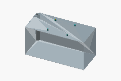](viewer/index.html?component=battery-box&mode=presentation)
| | |
| --- | --- |
| Outer study envelope | 542 × 278 × 241 mm; roof locally sloped |

**Read more:** [Battery box and controller standoffs (3 mm proposal) technical detail](../technical/modules/04-battery-and-charging/batteries.md#sliding-battery-cassette) · [Technical evidence](../technical/modules/04-battery-and-charging/batteries.md#sliding-battery-cassette)

### Moving battery tray (8 mm steel proposal)

**Status:** Custom 8 mm steel tray proposal. Plate load screen is not qualification of brackets, joints or service stability.

| | |
| --- | --- |
| Tray / load screen | 8 mm S235; 85 kg at 1.5 g; 305 mm extraction |

**Read more:** [Moving battery tray (8 mm steel proposal) technical detail](../technical/modules/04-battery-and-charging/batteries.md#sliding-battery-cassette) · [Technical evidence](../technical/modules/04-battery-and-charging/batteries.md#sliding-battery-cassette)

### Fixed ball-guide stages and frame towers

**Status:** Accuride envelope / custom mount study; catalog capacity is not a mower shock or fatigue rating. Excluded from baseline costs.

| | |
| --- | --- |
| Guide | 305 mm travel; 76.2 × 19.1 mm section, vertical mounting |
| Public price | €119.19 net per pair; €238.38 net for two pods |

**Read more:** [Fixed ball-guide stages and frame towers technical detail](../technical/modules/04-battery-and-charging/batteries.md#sliding-battery-cassette) · [RS Ireland priced pair](https://ie.rs-online.com/web/p/drawer-runners/1886905) · [Accuride datasheet](https://hs-europe.accuride.com/hubfs/Datasheets/9301U-E_en.pdf) · [Technical evidence](../technical/modules/04-battery-and-charging/batteries.md#s40-accuride-battery-extraction-guides)

### Intermediate ball-guide stages (half travel)

**Status:** See technical scope; this is a study element.

**Read more:** [Intermediate ball-guide stages (half travel) technical detail](../technical/modules/04-battery-and-charging/batteries.md#sliding-battery-cassette)

### Inner ball-guide stages and tray brackets

**Status:** See technical scope; this is a study element.

**Read more:** [Inner ball-guide stages and tray brackets technical detail](../technical/modules/04-battery-and-charging/batteries.md#sliding-battery-cassette)

### Tray locking pin (work / extract)

**Status:** Two-position positive pin proposal; retention, end stops and engagement indication are not released.

[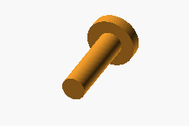](viewer/index.html?component=tray-lock-pin&mode=presentation)
| | |
| --- | --- |
| WORK / EXTRACT | 12 mm pin; 12.5 mm bores, 305 mm apart; 45 mm release |

**Read more:** [Tray locking pin (work / extract) technical detail](../technical/modules/04-battery-and-charging/batteries.md#sliding-battery-cassette) · [Technical evidence](../technical/modules/04-battery-and-charging/batteries.md#sliding-battery-cassette)

### Moving locking strip (two 12.5 mm bores)

**Status:** See technical scope; this is a study element.

[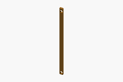](viewer/index.html?component=tray-lock-strike&mode=presentation)

**Read more:** [Moving locking strip (two 12.5 mm bores) technical detail](../technical/modules/04-battery-and-charging/batteries.md#sliding-battery-cassette)

### EZ-A48500 (200 x 164 x 70.47 mm)

**Status:** Published A-series envelope; terminal offsets, thermal path and exact supplied revision require confirmation.

[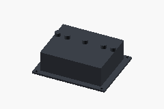](viewer/index.html?component=controller&mode=presentation)
| | |
| --- | --- |
| Drawing envelope | 200 × 164 × 70.47 mm; mounted on moving battery box |

**Read more:** [EZ-A48500 (200 x 164 x 70.47 mm) technical detail](../technical/modules/02-drive-train/propulsion.md#ez-a48500-controller-candidate) · [Golden Motor manual, A-series drawing](https://www.goldenmotor.com/controllers/EZkontrol%20Users%20Manual.pdf) · [Technical evidence](../technical/modules/02-drive-train/propulsion.md#ez-a48500-controller-candidate)

### Battery to controller (protected routing proposal)

**Status:** See technical scope; this is a study element.

**Read more:** [Battery to controller (protected routing proposal) technical detail](../technical/modules/05-power-cables-and-electronics/cables-connectors.md#battery-cassette-harness)

### Controller phase leads / moving disconnect half

**Status:** See technical scope; this is a study element.

[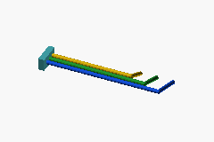](viewer/index.html?component=controller-harness&mode=presentation)

**Read more:** [Controller phase leads / moving disconnect half technical detail](../technical/modules/05-power-cables-and-electronics/cables-connectors.md#battery-cassette-harness)

### Motor phase leads / fixed disconnect half

**Status:** See technical scope; this is a study element.

**Read more:** [Motor phase leads / fixed disconnect half technical detail](../technical/modules/05-power-cables-and-electronics/cables-connectors.md#battery-cassette-harness)

### Rubber track (200x72x40 candidate fit study)

**Status:** Current CAD candidate; modeled clashes cleared with provisional margins. Profile and load compatibility remain unqualified.

[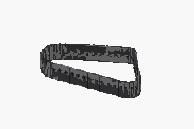](viewer/index.html?component=track&mode=presentation)
| | |
| --- | --- |
| Candidate dimensions | 200 × 72 × 40 (listed size) |
| Listed price | €119.27 each; €110.92 each at 2+ (incl. listed Italian VAT) |

**Read more:** [Rubber track (200x72x40 candidate fit study) technical detail](../technical/modules/01-structure-and-running-gear/running-gear.md#pod-fit-cad-assumptions) · [PowerTrack product 2055](https://www.powertrack.it/en/powertrack-rubber-tracks/2055-Rubber-tracks-for-miniexcavators-200x72x40-0793596792076.html) · [Technical evidence](../technical/modules/01-structure-and-running-gear/running-gear.md#s39-longer-powertrack-belt-candidates)

### Drive drum (350 mm placeholder)

**Status:** See technical scope; this is a study element.

[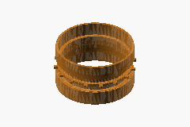](viewer/index.html?component=drive-drum&mode=presentation)

**Read more:** [Drive drum (350 mm placeholder) technical detail](../technical/modules/01-structure-and-running-gear/running-gear.md#drive-drum-study)

### Idler (paired 200x50 wheels; candidate)

**Status:** Priced wheel candidate; track profile and load fit unverified.

[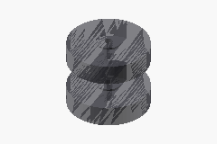](viewer/index.html?component=idler&mode=presentation)
| | |
| --- | --- |
| Wheel envelope | 200 mm OD × 50 mm tread; paired study |
| Listed price | €26.55 per wheel; €53.10 per pair, ex VAT |

**Read more:** [Idler (paired 200x50 wheels; candidate) technical detail](../technical/modules/01-structure-and-running-gear/running-gear.md#tensioner-and-idler-interfaces) · [Interwheel 161.540](https://www.interwheel.eu/en/stainless-steel-pu-wheel-200-mm-500-kg.html) · [Technical evidence](../technical/modules/01-structure-and-running-gear/running-gear.md#s37-bearing-wheel-roller-and-idler-candidates)

### HPM5000B (body, shaft and mounting pattern)

**Status:** Main cost/study candidate; exact configuration and duty unqualified.

| | |
| --- | --- |
| Supplier family envelope | 206 mm diameter × 126 mm length |
| Planning price | €482.36 each; €964.72 for two bare motors |

**Read more:** [HPM5000B (body, shaft and mounting pattern) technical detail](../technical/modules/02-drive-train/propulsion.md#hpm5000b-main-motor-candidate) · [Golden Motor listing](https://goldenmotorcz.en.made-in-china.com/product/CwmnvfujhxVi/China-HPM5000B-48V-4000RPM-Brushless-DC-Motor-with-CE-Certificate.html) · [Technical evidence](../technical/modules/02-drive-train/propulsion.md#hpm5000b-ratings-and-sourcing-limits) · [Technical evidence](../technical/modules/02-drive-train/propulsion.md#hpm5000b-purchase-scope-and-price)

### Planetary stage 1 (pitch circles)

**Status:** See technical scope; this is a study element.

**Read more:** [Planetary stage 1 (pitch circles) technical detail](../technical/modules/02-drive-train/propulsion.md#hpm5000b-planetary-in-drum-study)

### Planetary stage 2 (pitch circles)

**Status:** See technical scope; this is a study element.

[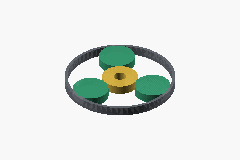](viewer/index.html?component=planetary-2&mode=presentation)

**Read more:** [Planetary stage 2 (pitch circles) technical detail](../technical/modules/02-drive-train/propulsion.md#hpm5000b-planetary-in-drum-study)

### Planetary stage 3 (pitch circles)

**Status:** See technical scope; this is a study element.

[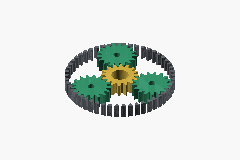](viewer/index.html?component=planetary-3&mode=presentation)

**Read more:** [Planetary stage 3 (pitch circles) technical detail](../technical/modules/02-drive-train/propulsion.md#hpm5000b-planetary-in-drum-study)

### Final carrier to drum (schematic)

**Status:** See technical scope; this is a study element.

[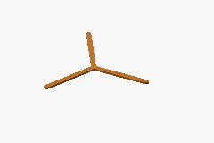](viewer/index.html?component=output-carrier&mode=presentation)

**Read more:** [Final carrier to drum (schematic) technical detail](../technical/modules/02-drive-train/propulsion.md#motor-to-track-mounting)

### Lower roller 1 (paired 120x50 PC/TPU study)

**Status:** Owner-selected printed concept; loading and durability unqualified.

| | |
| --- | --- |
| Wheel concept | 120 mm OD × 50 mm; PC core, TPU 95A tread |
| Material estimate | €182.45 net for 20 wheels at recorded sale prices |

**Read more:** [Lower roller 1 (paired 120x50 PC/TPU study) technical detail](../technical/modules/01-structure-and-running-gear/running-gear.md#lower-support-rollers) · [Elegoo PC filament](https://www.3djake.com/elegoo/pc-black-4) · [Elegoo TPU 95A filament](https://www.3djake.com/elegoo/tpu-95a-blue-2) · [6004-2RS bearings](https://www.kugellager-express.de/rillenkugellager-6004-2rs-20x42x12-mm) · [Technical evidence](../technical/modules/01-structure-and-running-gear/running-gear.md#s38-3d-printed-roller-wheels-owner-proposed)

### Lower roller 2 (paired 120x50 PC/TPU study)

**Status:** See technical scope; this is a study element.

**Read more:** [Lower roller 2 (paired 120x50 PC/TPU study) technical detail](../technical/modules/01-structure-and-running-gear/running-gear.md#lower-support-rollers)

### Lower roller 3 (paired 120x50 PC/TPU study)

**Status:** See technical scope; this is a study element.

**Read more:** [Lower roller 3 (paired 120x50 PC/TPU study) technical detail](../technical/modules/01-structure-and-running-gear/running-gear.md#lower-support-rollers)

### Lower roller 4 (paired 120x50 PC/TPU study)

**Status:** See technical scope; this is a study element.

[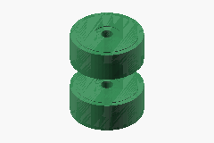](viewer/index.html?component=lower-roller-4&mode=presentation)

**Read more:** [Lower roller 4 (paired 120x50 PC/TPU study) technical detail](../technical/modules/01-structure-and-running-gear/running-gear.md#lower-support-rollers)

### Fixed upper roller (paired 120x50 study)

**Status:** Fixed raised return roller with U support and inboard mast; printed capacity and structural loads unqualified.

| | |
| --- | --- |
| Return wheel concept | Paired 120 × 50 mm PC/TPU wheels; axis Y = 535 mm |

**Read more:** [Fixed upper roller (paired 120x50 study) technical detail](../technical/modules/01-structure-and-running-gear/running-gear.md#fixed-upper-roller-support) · [Technical evidence](../technical/modules/01-structure-and-running-gear/running-gear.md#fixed-upper-roller-support)

### Battery tray (524x288x10 proposed plate)

**Status:** See technical scope; this is a study element.

**Read more:** [Battery tray (524x288x10 proposed plate) technical detail](../technical/modules/01-structure-and-running-gear/frame.md#ps04-frame-stock-and-weldments)

### Lower roller U supports and axles (proposal)

**Status:** Four proposed U supports; unchanged 120 mm wheels. Axle fits and structural capacity unqualified.

[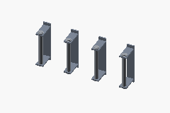](viewer/index.html?component=lower-roller-supports&mode=presentation)
| | |
| --- | --- |
| Support geometry | 6 mm cheeks; 20 mm axle; 4 mm bridge/tread gap |

**Read more:** [Lower roller U supports and axles (proposal) technical detail](../technical/modules/01-structure-and-running-gear/running-gear.md#lower-support-rollers) · [Technical evidence](../technical/modules/01-structure-and-running-gear/running-gear.md#lower-support-rollers)

### Connected motor-to-idler tray frame (proposal)

**Status:** Connected custom frame proposal; strength, joints and complete two-pod fit unqualified. No separately established price.

[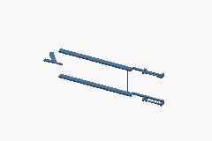](viewer/index.html?component=pod-frame&mode=presentation)
| | |
| --- | --- |
| Structural connection | Motor reaction plate → battery tray → sliding idler guides |

**Read more:** [Connected motor-to-idler tray frame (proposal) technical detail](../technical/modules/01-structure-and-running-gear/frame.md#connected-pod-frame-proposal) · [Technical evidence](../technical/modules/01-structure-and-running-gear/frame.md#connected-pod-frame-proposal)

### Motor reaction plate (250x12 proposal)

**Status:** Custom reaction-plate proposal on the published motor pattern; fasteners and loads unqualified.

[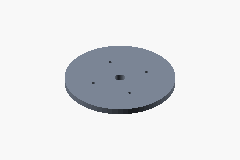](viewer/index.html?component=motor-mount&mode=presentation)
| | |
| --- | --- |
| Proposed plate | 250 mm OD × 12 mm; motor moves 12 mm outboard |

**Read more:** [Motor reaction plate (250x12 proposal) technical detail](../technical/modules/01-structure-and-running-gear/frame.md#motor-and-reducer-mounting-plates) · [Technical evidence](../technical/modules/01-structure-and-running-gear/frame.md#motor-and-reducer-mounting-plates)

### Sliding idler yoke and sleeves (proposal)

**Status:** Sliding front-idler proposal with geometric stops; usable belt travel and retained bearing fits unqualified.

[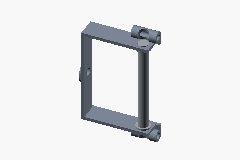](viewer/index.html?component=idler-carriage&mode=presentation)
| | |
| --- | --- |
| Geometric stroke | ±15 mm longitudinal; two 10 mm guides |

**Read more:** [Sliding idler yoke and sleeves (proposal) technical detail](../technical/modules/01-structure-and-running-gear/running-gear.md#sliding-idler-carriage) · [Technical evidence](../technical/modules/01-structure-and-running-gear/running-gear.md#sliding-idler-carriage)

### Idler spring, guide and reaction seat (proposal)

**Status:** Schematic compression spring, not a selected commercial part or qualified tension setting; no established price.

[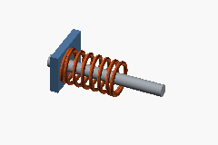](viewer/index.html?component=idler-spring&mode=presentation)
| | |
| --- | --- |
| Coil proposal | 36 mm OD, 4 mm wire; 57.036 mm nominal installed envelope |

**Read more:** [Idler spring, guide and reaction seat (proposal) technical detail](../technical/modules/01-structure-and-running-gear/running-gear.md#spring-tensioner-concept) · [Technical evidence](../technical/modules/01-structure-and-running-gear/running-gear.md#spring-tensioner-concept)

### Fixed upper U support and inboard mast (proposal)

**Status:** Fixed U support, axle and braced inboard mast proposal; loads and joints unqualified.

[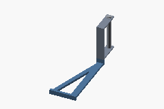](viewer/index.html?component=upper-roller-support&mode=presentation)
| | |
| --- | --- |
| Packaging | 29 mm wheel/bridge gap; 16 mm intrusion into central space |

**Read more:** [Fixed upper U support and inboard mast (proposal) technical detail](../technical/modules/01-structure-and-running-gear/running-gear.md#fixed-upper-roller-support) · [Technical evidence](../technical/modules/01-structure-and-running-gear/running-gear.md#fixed-upper-roller-support)

### DC HOUSE battery (504x268x233 listing envelope)

**Status:** Listing body clears the revised CAD. Supplied dimensions, terminals, restraints and complete vehicle fit remain on hold.

[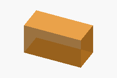](viewer/index.html?component=battery&mode=presentation)
| | |
| --- | --- |
| Pack envelope | 504 × 268 × 233 mm per pack |
| Bundle price | €849.99 each incl. listed 18 A charger; tax/delivery unconfirmed |

**Read more:** [DC HOUSE battery (504x268x233 listing envelope) technical detail](../technical/modules/04-battery-and-charging/batteries.md#provisional-battery-clearance) · [DC HOUSE EU/non-DE bundle](https://de.dchousepower.com/products/5-tage-bearbeitungszeit48v-100ah-lifepo4-batterie-mit-metallgehause-bluetooth-und-niedertemperaturschutz-ladegerat-ausserhalb-de) · [Technical evidence](../technical/modules/04-battery-and-charging/batteries.md#s30-dc-house-100-ah-charger-bundle)

### Battery removal arrow (annotation)

**Status:** See technical scope; this is a study element.

[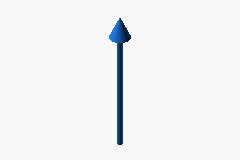](viewer/index.html?component=removal-arrow&mode=presentation)

**Read more:** [Battery removal arrow (annotation) technical detail](../technical/modules/04-battery-and-charging/batteries.md#battery-to-pod-fit)

[↑ Back to presentation](README.md#engineering-pitch)
