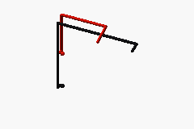
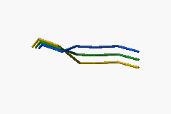

# Cables, connectors and harnesses

**Status:** DRAFT / HOLD; engineering estimate and unqualified requirements.
No procurement, fabrication, energizing or operation is authorized.

**Summary:** Inspect a cable or connector, then follow the device at either
end and the tooling needed to assemble it. Sizes, pin maps, complete mating
parts, and routing remain unselected; quantities are not a harness cut list.

## Parts at a glance

| Part to inspect | Current choice / status | Cost and specifications | Connects to / assembly detail |
| --- | --- | --- | --- |
| [High-current cable](cables-connectors.md#ps23-high-current-harness) | Length allowance only; conductor section/derating open | [Cable cost](cables-connectors.md#0501-high-current-cable) · [Cable requirements](cables-connectors.md#ps23-high-current-harness) | [Battery terminals](../04-battery-and-charging/batteries.md#ps18-battery-packs-and-bms) · [Fuse and disconnect](power-distribution.md#ps21-main-fuses-disconnects-and-contactors) |
| [Lugs and power connectors](cables-connectors.md#ps23-high-current-harness) | No exact MPN, contact or seal set selected | [Connector/insulation costs](cables-connectors.md#0502-power-lugs-connectors-and-terminal-insulation) · [Mating/crimp requirements](cables-connectors.md#ps23-high-current-harness) | [Crimp tools and dies](../07-workshop-and-support/workshop.md#ps36-instruments-and-workshop-tools) · [Controller terminals](../02-drive-train/propulsion.md#ps14-traction-motor-and-controller) |
| [Signal cable and connectors](cables-connectors.md#ps26-signal-harness-and-communications) | Pin maps, shielding and moving-loop geometry open | [Cable costs](cables-connectors.md#0503-control-and-communications-cables) · [Connectors/routing costs](cables-connectors.md#0504-signal-connectors-conduit-clips-and-labels) · [Signal requirements](cables-connectors.md#ps26-signal-harness-and-communications) | [Control boards](../06-safety-controls-and-sensors/safety-controls.md#ps29-normal-control-and-diagnostics) · [Sensors/logger](../06-safety-controls-and-sensors/safety-controls.md#ps31-installed-instrumentation-and-logging) |
| Charge and width-drive harnesses | Owned and budgeted in their respective scopes, not added here | [Charge harness](../04-battery-and-charging/batteries.md#ps20-charging-and-charge-interlocks) · [Width harness](../03-width-adjustment/width-adjustment.md#ps13-width-harness-and-screw-guard) | [Charge interlock](../06-safety-controls-and-sensors/safety-controls.md#ps28-independent-stopping-and-normal-control) · [Moving scissor mechanism](../01-structure-and-running-gear/frame.md#ps05-scissor-pivots) |

**3D routing study:** simplified 12 mm cable envelopes, not selected conductor
sizes. All harnesses are fixed; only the battery, open tray, base-clamp concepts and
inner guide move. Battery leads bolt directly to the pack terminals with no
extra connector. The **red P+ lead** runs on the inboard side through the
E-stop-controlled main contactor to controller B+; the **black P- lead** runs
direct to B-. Both remain one selectable harness in the viewer. Phase leads run
directly from the motor to U/V/W in staggered-height lanes around the drum
and stay inside the track side silhouette. Battery and phase leads never cross in plan
above the battery. These are not impact guards, bend-radius or support
designs.

| Battery leads via contactor | Motor phase leads (direct) |
| --- | --- |
|  |  |

**Further detail:** [Release requirements](cables-connectors.md#specification-and-inspection-requirements) ·
[Sourcing](cables-connectors.md#sourcing) ·
[Interfaces](cables-connectors.md#interfaces-with-other-scopes) ·
[Itemized costs](cables-connectors.md#detailed-module-costs)

**Related documents:** [Chassis BOM](../../bom/chassis-bom.md) ·
[All modules](../README.md#module-directory)

## Specification and inspection requirements

All specifications are **HOLD**. Checks describe evidence still required, not
completed tests. Cost-ledger ranges are inclusive.

### PS23: High-current harness

**Cost-ledger coverage:** PWR-008:PWR-011

**Part links:** [Cable cost](cables-connectors.md#0501-high-current-cable) ·
[Connector/insulation costs](cables-connectors.md#0502-power-lugs-connectors-and-terminal-insulation) ·
[Fuse coordination](power-distribution.md#ps21-main-fuses-disconnects-and-contactors) ·
[Crimp tool compatibility](../07-workshop-and-support/workshop.md#ps36-instruments-and-workshop-tools).

**Required purchasing/manufacturing definition:** Cable
section/insulation/temperature/flex class, lengths and derating; lug/terminal/stud
compatibility, connector complete mating BOM and full-voltage DC rating; crimp tooling
and terminal insulation

**Receiving or first-article evidence:** Harness drawing/cut list, crimp process
evidence and specified pull checks, continuity/polarity, strain relief and tightening
records; no universal wire size or fuse rating inferred from motor kW

### PS26: Signal harness and communications

**Cost-ledger coverage:** PWR-017:PWR-020

**Part links:** [Signal-cable costs](cables-connectors.md#0503-control-and-communications-cables) ·
[Connector/routing costs](cables-connectors.md#0504-signal-connectors-conduit-clips-and-labels) ·
[Sensor connections](../06-safety-controls-and-sensors/safety-controls.md#ps31-installed-instrumentation-and-logging) ·
[Moving width harness](../03-width-adjustment/width-adjustment.md#ps13-width-harness-and-screw-guard).

**Required purchasing/manufacturing definition:** Signal wire size, shielding/bonding,
topology/termination, connector pin maps and unused-cavity seals; moving-loop bend
radius/flex life, clips/labels and protected service loops

**Receiving or first-article evidence:** Pin-to-pin record, shield/ground inspection,
full-travel routing check and defined communications fault evidence; separate safety and
normal control as designed

### Battery cassette harness

**Routing proposal, not an electrical assembly drawing:** the
[DC HOUSE S30](../04-battery-and-charging/batteries.md#s30-dc-house-100-ah-charger-bundle)
offer photograph shows black P- and red P+ on the same short end beside a handle.
After the upright 180-degree rotation the CAD orients that end toward +X,
with **provisional** landings at X = 305, Y = 348, Z = +123 / -35 mm
for P- / P+. M8 is evidenced; exact centers, stud/boot
envelopes and torques are not. There is no battery box, gland or battery
connector: ring lugs bolt directly to the pack studs, and unbolting them is
the first removal step.

The [controller manual](https://www.goldenmotor.com/controllers/EZkontrol%20Users%20Manual.pdf)
establishes B+/U/V/W/B- order and the three motor-phase connections (PDF pages
7 and 11); terminal centers in the model remain approximate. The modeled
P+ lands on B+ through the contactor and P- lands on B-. Before any actual
connection, identify the supplied terminals by their markings and independently
verify polarity under a qualified electrical procedure; cable color and the
illustrative positions are not proof of the supplied hardware's polarity.
From the P+ lug
the red lead rises to a 45 x 70 x 70 mm **main contactor envelope** at
X = 140-185, Y = 411-481, Z = -70 to 0 mm on the fixed support. The
assumed top studs and their order are placeholders, not selected hardware.
Its output feeds B+ at X = 53, Z = -31 mm; P- feeds B- at X = 53,
Z = 121 mm. The terminal approach centerline is Y = 487.47 mm. Fixed leads
clear the moving battery, tray and base-clamp sweep through 305 mm extraction.

Yellow/green/blue phase envelopes leave the provisional motor landing at
X = -440, Y = 265, Z = 122 mm; the three provisional landings are spaced
18 mm along X. They climb in lanes at Y = 340/320/300 mm, pass outboard of
the drive drum, then turn inboard and rise behind the pack directly to
U/V/W, with no connector. Power tubes keep at least 5 mm to the modeled
upper rollers and their support; individual phase tubes also keep 5 mm to
each other, the drum and the track. A 10 mm capsule grown around their side-view
projection stays inside the track side silhouette, so they do not protrude
over the track. The motor endpoint is a **provisional outboard-face pigtail
landing**, not an evidenced HPM terminal position.

**Connection order:** battery -> main fuse -> E-stop-controlled main
contactor -> controller B+; battery - -> controller B-; controller U/V/W ->
motor directly. The E-stop chain opens the high-current main contactor
coil, so one E-stop disconnects both packs. Build: connect motor phases and Hall/sensor leads to the
controller first, then control, KSI and contactor coil wiring, and the
battery lugs last (B+ then B-), under a qualified isolation procedure.
After establishing a safe state, the first battery-removal step is unbolting
B- then B+ and separately insulating the live terminals and removed lugs,
before unpinning and sliding the tray. E-stop/contactors alone do not provide
service isolation. Phase leads stay connected. Never break phase leads while powered
or while the motor can turn, because back-EMF can energize them. Do not drill
or cut a harness from these coordinates.

**Cable length is a high-priority design constraint.** Battery and motor
power leads take the shortest route that still clears the track side
silhouette, the tray slide and the battery lift path. The fit study holds
them to length budgets (P+ about 332 mm via the contactor, P- about 320 mm,
phases about 656.3/612.2/583.6 mm; centerline lengths only). The thicker
reaction plate moves the motor landing 4 mm outboard; the existing
660/615/585 mm individual and 1,855 mm total phase budgets still apply.
Compared with the prior
off-center layout, P+ grows about 18 mm to pass the upper roller and support
after the battery rotation; P- grows about 8 mm to reach the centered controller
without clipping its cover. The combined phases are about 201 mm shorter.
The controller's terminal row spans the pod and the controller is centered
over the battery at the owner's request. The phases must still climb from
the motor face to the controller above the tray. The
E-stop operator is beside the controller (see
[PS21](power-distribution.md#ps21-main-fuses-disconnects-and-contactors)), so
its low-current coil loop, not the power leads, is the run that grows.

The cable tubes are routing/space reservations, **not direct unfused wiring
instructions**. The required main fuse, contactor rating, coil supply and
precharge belong to [power distribution](power-distribution.md#ps21-main-fuses-disconnects-and-contactors);
only the contactor envelope is packaged by this model. Sensor/Hall,
temperature, control, charge, bonding and interlock wiring remain unmodeled,
but must also disconnect or remain protected before tray movement. Lug size,
touch protection, strain relief, clips, edge protection and terminal boots
remain HOLD.

Cable bends are deliberately simple capsules, not proof of minimum bend radius,
flex life, thermal derating or ampacity. There is no dynamic service loop.
The CAD sequence is not authorization to energize or handle a battery.

[↑ Back to document overview](cables-connectors.md#cables-connectors-and-harnesses)

## Sourcing

[RS Romania cables, connectors and tools (S07)](../../bom/sources.md#s07-rs-electrical-parts-and-tools).

Catalog links and price proxies are not approved suppliers or delivered quotes.

[↑ Back to document overview](cables-connectors.md#cables-connectors-and-harnesses)

## Interfaces with other scopes

| Interface | Owning detail |
| --- | --- |
| Cable protection and power switching | [Main fuses, disconnects and contactors](power-distribution.md#ps21-main-fuses-disconnects-and-contactors) |
| Stop circuits versus normal control wiring | [Independent stopping](../06-safety-controls-and-sensors/safety-controls.md#ps28-independent-stopping-and-normal-control) |
| Moving width-drive wiring | [Width harness and screw guard](../03-width-adjustment/width-adjustment.md#ps13-width-harness-and-screw-guard) |
| Charge connectors and motion inhibit | [Charging and charge interlocks](../04-battery-and-charging/batteries.md#ps20-charging-and-charge-interlocks) |

[↑ Back to document overview](cables-connectors.md#cables-connectors-and-harnesses)

## Detailed module costs

**Cost context:** [Module 05 totals](../../cost-breakdown.md#05--power-cables-and-electronics) ·
[Ledger and assumptions](../../bom/chassis-bom.csv) ·
[Release checklist](../../chassis-build-requirements.md).

<!-- BEGIN GENERATED: details -->
Generated from the [cost ledger](../../bom/chassis-bom.csv).
Quantities are cumulative Stage 2; prices are line totals, not unit prices.
Item links open the purchasing and inspection requirements.
C = calculated reference; A = allowance; I = included; R = reused.
N/A never means an unknown purchase is free.

### 05.01 High-current cable

| Item / cumulative quantity | 48 V total / basis |
| --- | ---: |
| [PWR-008 - High-current cable](cables-connectors.md#ps23-high-current-harness) (10 m) | €90.00 / A |
| **Module subtotal** | €90.00 |

### 05.02 Power lugs connectors and terminal insulation

| Item / cumulative quantity | 48 V total / basis |
| --- | ---: |
| [PWR-009 - Power cable lugs](cables-connectors.md#ps23-high-current-harness) (24 each) | €48.00 / A |
| [PWR-010 - High-current sealed connector](cables-connectors.md#ps23-high-current-harness) (4 pair) | €100.00 / A |
| [PWR-011 - Power insulation heat-shrink and terminal boots](cables-connectors.md#ps23-high-current-harness) (1 lot) | €20.00 / A |
| **Module subtotal** | €168.00 |

### 05.03 Control and communications cables

| Item / cumulative quantity | 48 V total / basis |
| --- | ---: |
| [PWR-017 - Low-voltage control wire](cables-connectors.md#ps26-signal-harness-and-communications) (50 m) | €40.00 / A |
| [PWR-018 - Shielded communications cable](cables-connectors.md#ps26-signal-harness-and-communications) (15 m) | €45.00 / A |
| **Module subtotal** | €85.00 |

### 05.04 Signal connectors conduit clips and labels

| Item / cumulative quantity | 48 V total / basis |
| --- | ---: |
| [PWR-019 - Sealed signal connectors](cables-connectors.md#ps26-signal-harness-and-communications) (12 pair) | €60.00 / A |
| [PWR-020 - Conduit loom P-clips ties and wire labels](cables-connectors.md#ps26-signal-harness-and-communications) (1 lot) | €35.00 / A |
| **Module subtotal** | €95.00 |

| Scope total | 48 V |
| --- | ---: |
| **All items owned by this scope** | €438.00 |
<!-- END GENERATED: details -->

[↑ Back to document overview](cables-connectors.md#cables-connectors-and-harnesses)
